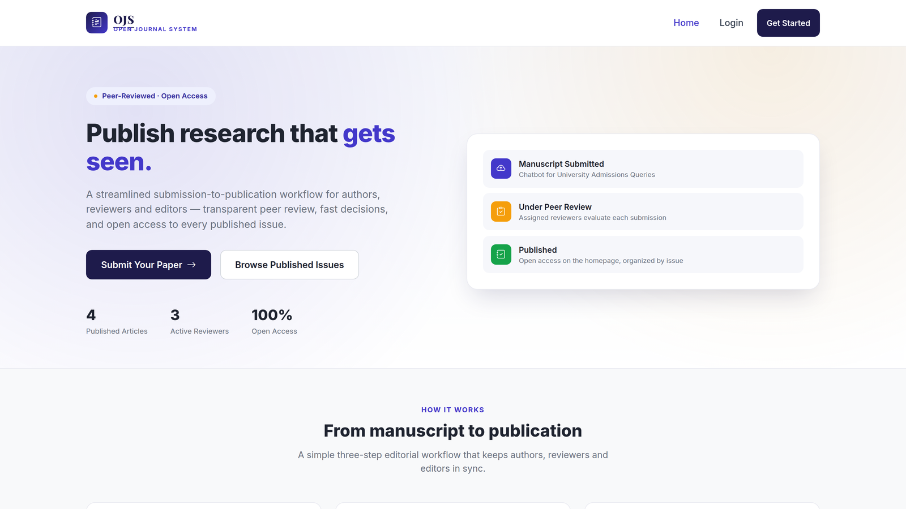
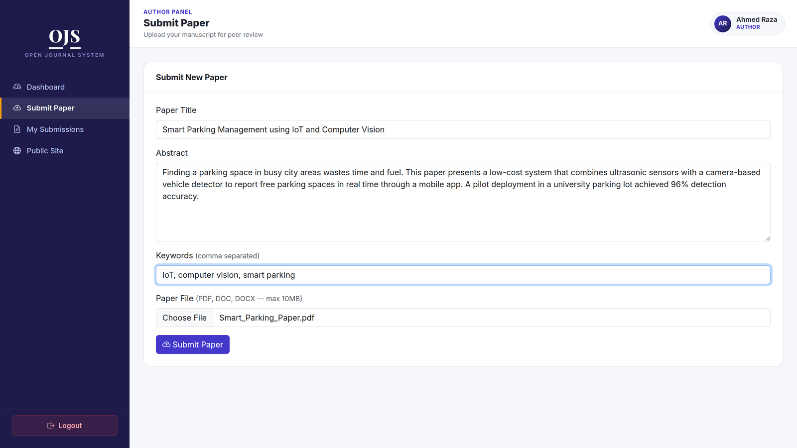
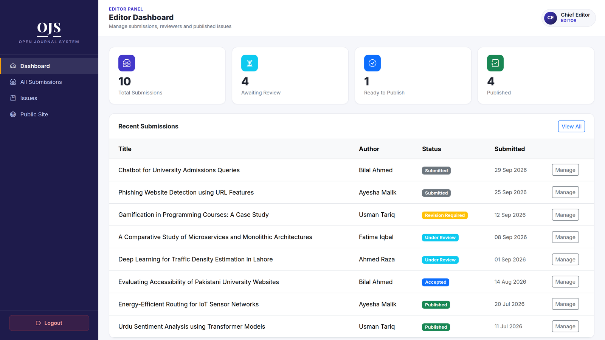
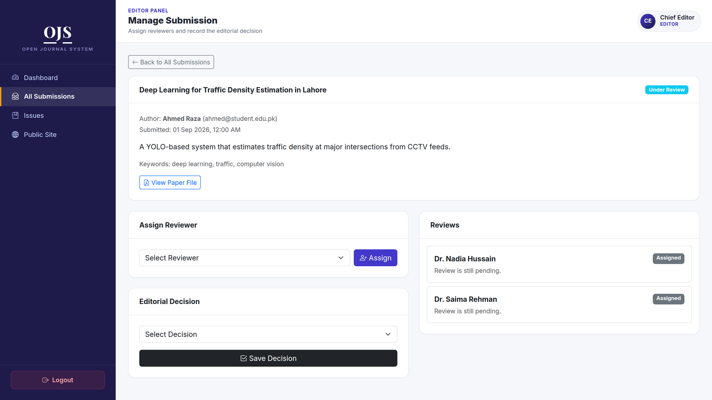
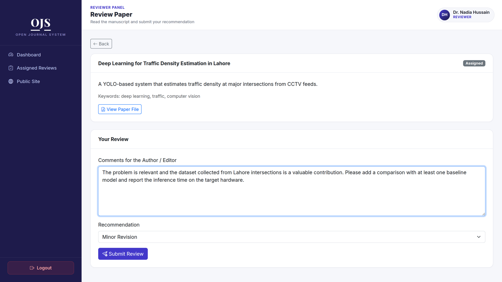
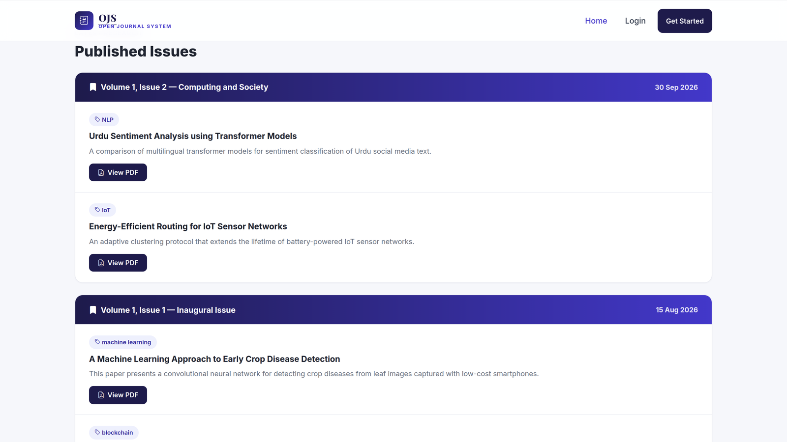

# OJS-style Journal Management System

A lightweight, OJS-inspired scholarly journal management system built with **PHP, MySQL and Bootstrap 5**. Supports the core academic publishing workflow: **Submit → Review → Publish**, with three role-based dashboards (Author, Reviewer, Editor).

## Features

- Role-based authentication (Author / Reviewer / Editor) with a single login system
- Author: submit papers (title, abstract, keywords, PDF/DOC/DOCX upload), track submission status, read reviewer feedback
- Reviewer: view assigned papers, submit comments + recommendation (Accept / Minor Revision / Major Revision / Reject)
- Editor: view all submissions, assign reviewers, make editorial decisions, create issues, and publish accepted papers
- Public homepage listing all published issues and papers (no login required)
- Professional, responsive dashboard UI with a sidebar layout, stat cards and status badges
- Secure password hashing (bcrypt), prepared statements (SQL-injection safe), upload folder locked against script execution

## Screenshots

**Public homepage**


**Author submitting a new paper**


**Editor dashboard**


**Editor assigning reviewers and recording a decision**


**Reviewer submitting comments and a recommendation**


**Published issues page**


## Tech Stack

- **Frontend:** HTML, CSS, JavaScript, Bootstrap 5 (+ Bootstrap Icons)
- **Backend:** PHP (procedural, mysqli with prepared statements)
- **Database:** MySQL

## Requirements

- XAMPP / WAMP / MAMP (Apache + PHP 7.4+ + MySQL)
- A browser

## Setup Instructions

1. **Install XAMPP** (if not already installed) from https://www.apachefriends.org and start the **Apache** and **MySQL** services from the XAMPP Control Panel.

2. **Copy the project** into your server's web root:
   - Windows (XAMPP): copy the `ojs-system` folder into `C:\xampp\htdocs\`
   - macOS (XAMPP): copy into `/Applications/XAMPP/htdocs/`
   - Linux (XAMPP): copy into `/opt/lampp/htdocs/`

3. **Create the database:**
   - Open http://localhost/phpmyadmin
   - Click **Import** → choose the file `sql/schema.sql` from this project → click **Go**
   - This creates the `ojs_system` database with all tables and one seeded editor account.

4. **Check database credentials** in `config/db.php` (defaults match a fresh XAMPP install — usually no change needed):
   ```php
   $DB_HOST = 'localhost';
   $DB_USER = 'root';
   $DB_PASS = '';
   $DB_NAME = 'ojs_system';
   ```

5. **Open the app** in your browser:
   ```
   http://localhost/ojs-system/
   ```

## Demo Login

An Editor account is pre-seeded by `schema.sql`:

| Role   | Email            | Password   |
|--------|------------------|------------|
| Editor | editor@ojs.com   | editor123  |

Author and Reviewer accounts are created by registering on the **Register** page (choose the role at signup).

## Suggested Demo Flow

1. Register two accounts: one as **Author**, one as **Reviewer**.
2. Log in as **Author** → *Submit Paper* → fill the form and attach a PDF.
3. Log in as **Editor** (`editor@ojs.com` / `editor123`) → *All Submissions* → open the paper → *Assign Reviewer* (pick the Reviewer account you made).
4. Log in as **Reviewer** → *Review Now* → write comments, pick a recommendation, submit.
5. Log in as **Editor** → open the paper again → read the review → set **Editorial Decision** to *Accept*.
6. Go to **Issues** → create a new issue (e.g. Volume 1, Issue 1) → *Publish an Accepted Paper* → select the paper and the issue → *Publish*.
7. Log out (or open an incognito window) → visit the homepage → the paper now appears under the published issue.

## Project Structure

```
ojs-system/
├── config/
│   ├── config.php        # session, base-URL detection, bootstraps db + helpers
│   └── db.php             # MySQL connection settings
├── includes/
│   ├── functions.php      # auth helpers, flash messages, status badges
│   ├── header.php / footer.php        # layout for public pages
│   ├── navbar.php                     # public top navbar
│   └── dash_header.php / dash_footer.php  # sidebar layout for dashboards
├── assets/css/style.css   # all custom styling (theme, sidebar, cards)
├── author/                # author dashboard, submit form, my submissions
├── editor/                # editor dashboard, submissions list, review/decision, issues
├── reviewer/               # reviewer dashboard, review form
├── uploads/                # uploaded paper files (script execution blocked via .htaccess)
├── sql/schema.sql          # database schema + seed data
├── index.php               # public homepage (published issues/papers)
├── login.php / register.php / logout.php
└── README.md
```

## Notes / Possible Future Improvements

This is an MVP covering the core Submit → Review → Publish cycle. Not included (kept out of scope on purpose to fit the timeline):

- Email notifications (e.g. "you've been assigned a review")
- Multiple journals in one installation
- DOI assignment / Crossref / Google Scholar / DOAJ indexing ("Distribute" step)
- Multiple review rounds per submission, blind/double-blind review settings
- Admin panel for managing users/roles

These would be natural next steps if the project is extended beyond the FYP/MVP stage.
